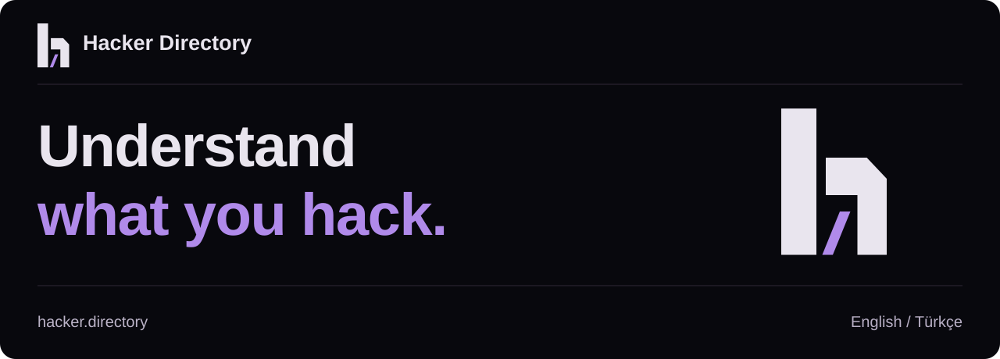

<p align="center"></p>

[Türkçe](README.tr.md) · [Hacker Directory](https://hacker.directory)

# URL Boundary Lab

Predict components, origin/site comparisons, and relative resolution before comparing native API output.

Foundational manual practice with synthetic local data. Workbooks: WEB-LAB-03. Each workbook ends with a short independent task and evidence criteria.

## Start

Download this repository as a ZIP and extract it, or clone it. Open a terminal in the repository folder. Node.js 20+ is sufficient; no package installation is needed.

```sh
cd lab
node inspect.mjs --reference "https://books.example/catalog#summary"
```

## Work through the lab

1. Read the [English workbook](lab/README.en.md); predict before observing.
2. Use [hints](lab/HINTS.en.md) when needed; read the [solution](lab/SOLUTION.en.md) after your run.
3. Complete the independent task and keep your prediction, observation, and explanation locally.

Related lessons: WEB-06.01, WEB-06.02, WEB-06.03. [Türkçe workbook](lab/README.md)

This is learning practice, separate from site exams and certificates. Personal evidence belongs in `.local-results/`, not Git commits. The workbook explains the model limits and reset steps.

**Understand what you hack.**
